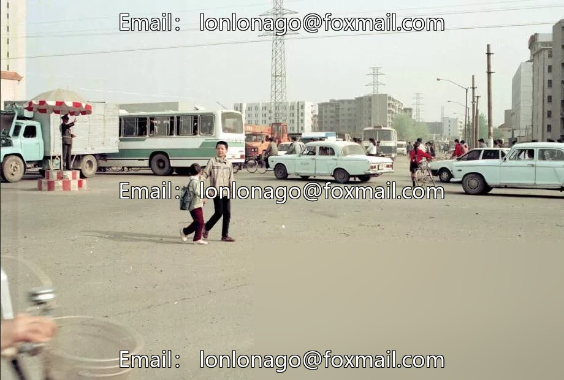
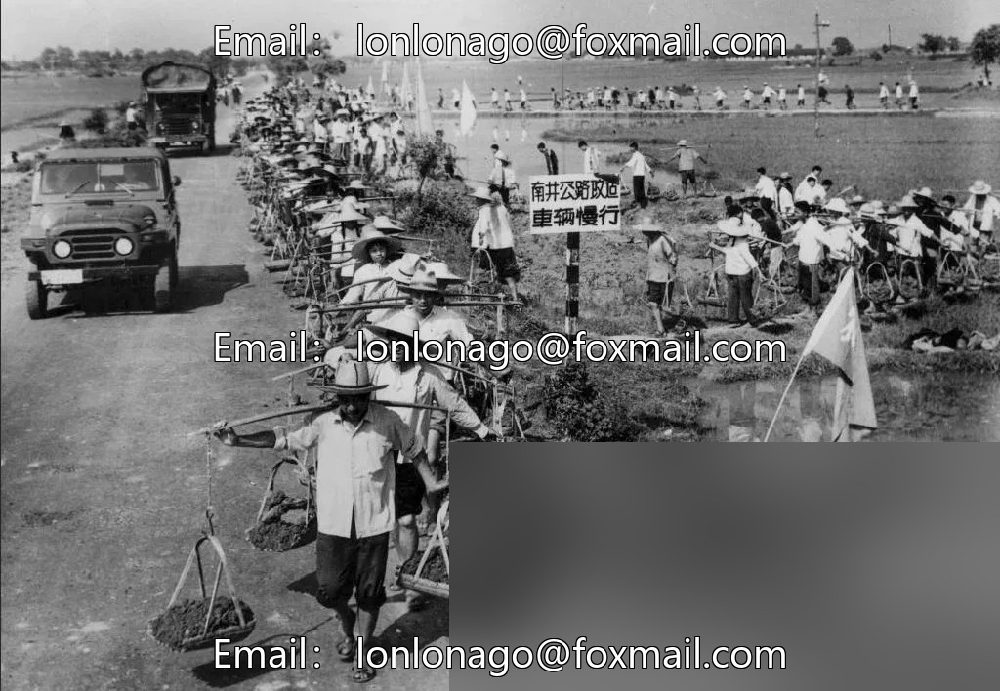
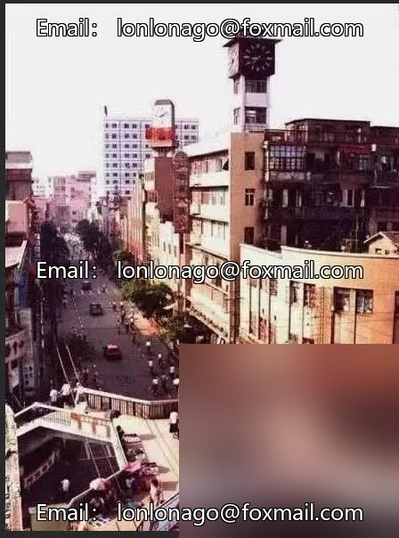
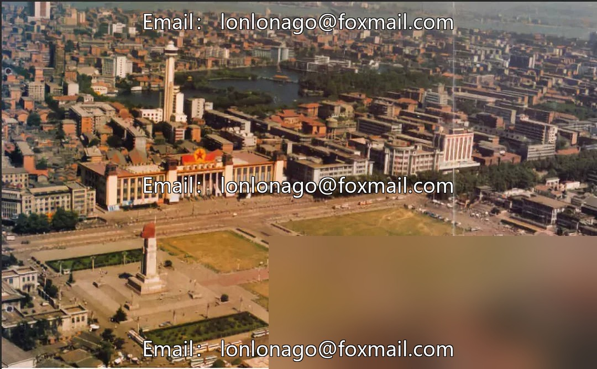
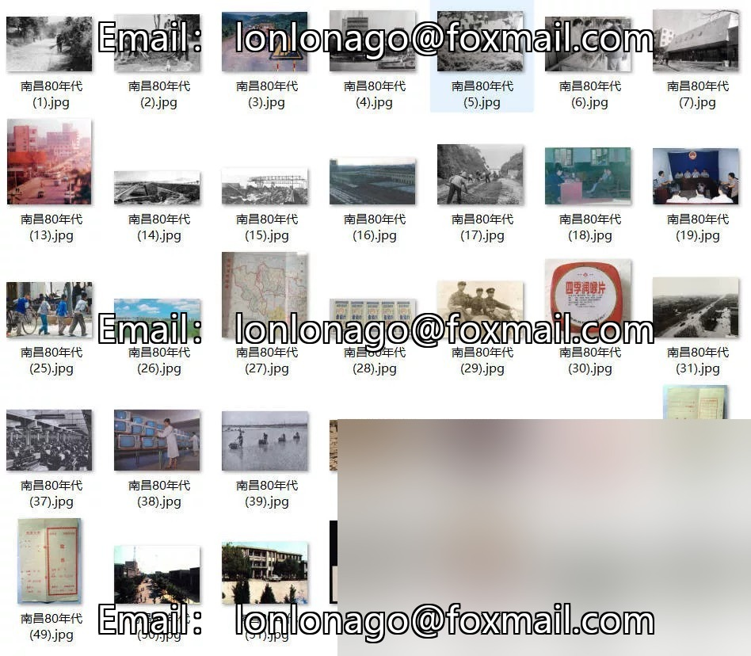
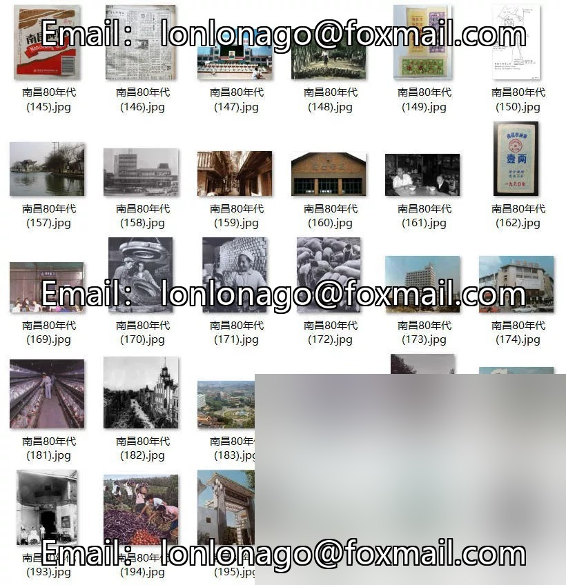

# Nanchang old photos , 80s old photos nostalgia , including figures, cities, and life

## Body

Nanchang old photo picture collection, old photos from the 1980s for nostalgic collection, including scenes of people, cities, and life, with a total of 199 black-and-white old photos of Nanchang rural and urban areas.

Because the camera quality was generally poor and the clarity was generally poor, please note!
network disk sharing.

The collection includes images of the Nanjing Road, Nanchang of the 1980s, and other scenes totaling 199 black-and-white old photos of the Nanchang countryside and city; the description also notes generally poor camera clarity and a web disk sharing.

<!-- AI_ENRICHED -->

## Images

## Payment

Here is a pay link on Stripe ( https://buy.stripe.com/3cs8yP7sY87d0vu9AB ). Please contact me lonlonago@foxmail.com after funding $89, and I will send you a complete data files , thank you!

